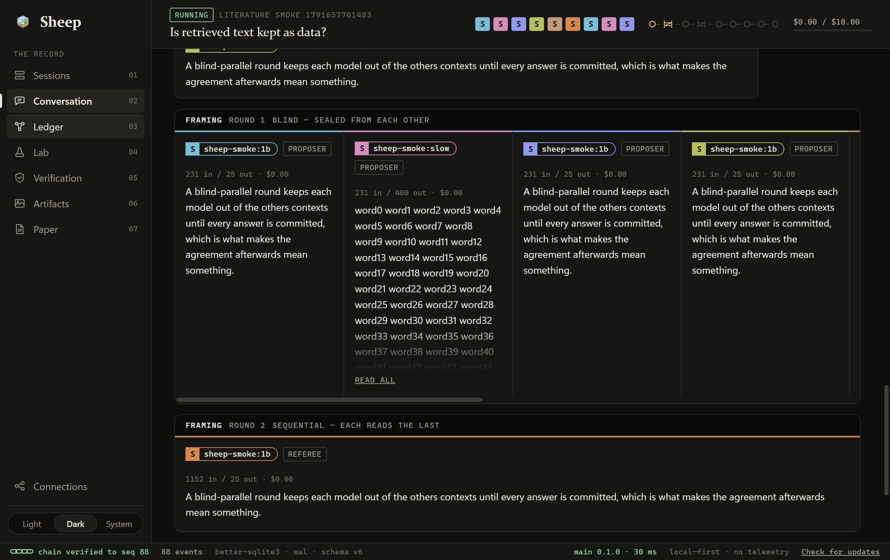
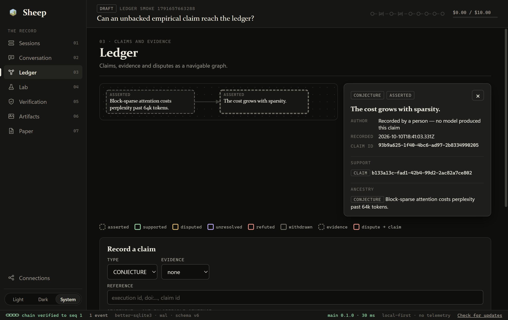
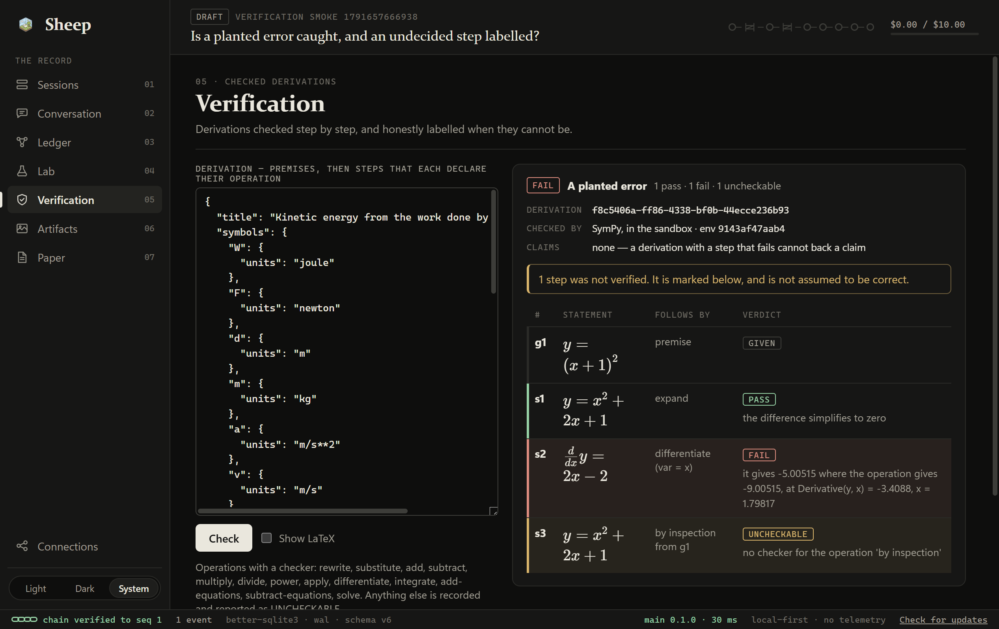
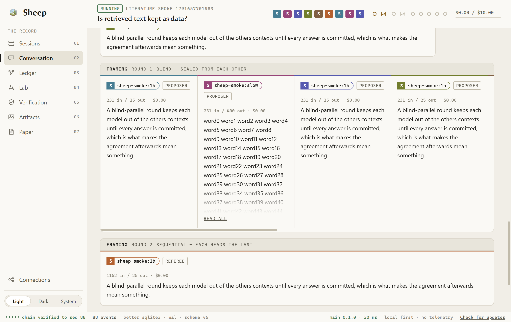

<div align="center">
  

  # Sheep

  **A multi-model sandbox for research you can check.**

  `v0.1.0-beta.1` · Windows x64 · MIT · local-first, no telemetry
</div>

> **This is a beta.** Sheep is feature-complete against its roadmap and passes
> its own automated checks, but it has only just started being used by people
> other than its author. Expect rough edges. If you are testing it, the
> [beta testing](#beta-testing) section is for you.



## Contents

- [Why Sheep exists](#why-sheep-exists)
- [What it does](#what-it-does)
- [What Sheep claims](#what-sheep-claims)
- [What Sheep does not claim](#what-sheep-does-not-claim)
- [How a session runs](#how-a-session-runs)
- [A look at the app](#a-look-at-the-app)
- [How it is built](#how-it-is-built)
- [Beta testing](#beta-testing)
- [What leaves your machine](#what-leaves-your-machine)
- [Documentation](#documentation)
- [Licence](#licence)

## Why Sheep exists

Ask one language model a research question and you get a fluent answer. What
you do not get is any way to tell which sentences in it are true. Four things
go wrong, and they compound:

1. **A model cannot referee itself.** Asking a model to "critique your answer"
   gets the same weights, with the same blind spots, playing a second role. It
   agrees with itself more often than it should.
2. **Models that can see each other converge.** Put several models in one
   thread and the first confident answer anchors the rest. Agreement then
   tells you who spoke first, not what is true.
3. **A number in prose is not a result.** A model will write "accuracy rose to
   94.2%" whether or not anything was ever run. Nothing on the page separates a
   measurement from a guess.
4. **Disagreement gets argued away.** When two models disagree, the usual fix
   is to ask a third which is right. That is a vote, not evidence.

Sheep is an attempt to remove each of these by construction rather than by
prompt. Its purpose is narrow: take **one research question** and produce a
record in which every assertion can be traced to what it rests on — a run, a
checked derivation, a retrieved source — or is plainly labelled as resting on
nothing.

## What it does

Sheep runs a research question past several AI models from **different
vendors**. It makes each commit to an answer before it sees anyone else's, has
models from one vendor critique the work of another, and settles every
disagreement it can by running code or checking a derivation — not by asking a
model who is right. What comes out is a paper in which every sentence that
asserts something names the evidence behind it, and a bundle that redraws the
paper's figures from scratch.

It is a desktop app. There is no server and no account. Your sessions, keys
and results stay on your machine.

## What Sheep claims

These are guarantees the code enforces, whatever the models say. Each one
names where it is enforced, so it can be checked rather than believed.

| Claim | What it means | Enforced by |
|---|---|---|
| **Attribution is physical** | A critic is a _different vendor's model_, never the same model playing a role. Nobody critiques itself. A single-vendor roster cannot run. | The role solver, `packages/orchestrator/src/roles.ts` |
| **Claims are typed** | Every claim is `EMPIRICAL`, `DERIVED`, `CITED` or `CONJECTURE`. An empirical claim with no recorded run behind it cannot be written down at all. | The ledger, `packages/core/src/ledger.ts` |
| **Independent before collective** | Every phase opens blind and in parallel. No model's context contains another's answer until all are committed, so agreement afterwards means something. | The blind runner, `packages/orchestrator/src/blind.ts` |
| **Verification is not a model** | SymPy, Z3, pint and a sandboxed Python decide. A model may only propose _what_ to check. | Test routing, `packages/orchestrator/src/routing.ts` |
| **Reproducibility is a build artifact** | Everything is an entry in an append-only, hash-chained event log that replays any session. Figures regenerate byte for byte from stored source. | The event log and the pinned, deterministic sandbox and renderers |
| **Disagreement is output** | A dispute no test could settle ships in the paper as an open question, with both positions as stated. A referee may write a rationale but cannot overrule a test. | Resolution, `packages/orchestrator/src/resolution.ts` |
| **Local-first** | No server, no telemetry, no crash reporting. Keys live in the operating system's credential store. | There is no server to send anything to |

What each claim type must rest on:

| Type | It must rest on | Can it be established? |
|---|---|---|
| `EMPIRICAL` | A sandbox run that exited cleanly | Yes |
| `DERIVED` | A derivation with no failing step | Yes |
| `CITED` | A source a literature search actually returned | No — it can only support other claims |
| `CONJECTURE` | Nothing | No |

Two smaller promises follow from these and are worth stating on their own:

- **A citation typed from memory is refused.** A `CITED` claim can only point
  at a source this session's search returned, because nothing else shows the
  source exists.
- **The paper refuses to compile around an unbacked sentence.** A sentence
  that asserts something must name a claim in the ledger, or the build stops
  and shows you the sentence.

## What Sheep does not claim

Being exact about the limits is part of the point.

- **It does not make research true.** It makes research _checkable_. A run
  that exits cleanly can still measure the wrong thing; a derivation can be
  valid and start from a bad premise. Sheep tells you what each claim rests
  on. Judging whether that is enough is still yours.
- **It is only as good as its models.** Weak models produce weak hypotheses
  and weak tests. The protocol stops them from laundering a guess into a
  finding; it does not make them clever.
- **Not every step can be checked.** A derivation step no checker can decide
  is marked `UNCHECKABLE`. It is never counted as a pass and never hidden, but
  it is also not verified.
- **A citation is not a verified fact.** `CITED` means "a search returned this
  source", not "this source is right". That is why a cited claim can never be
  marked established.
- **The sandbox is not a security boundary.** It contains runaway code —
  capped memory and CPU, a timeout, no network, no writes outside its own
  directory. It is not a defence against code written deliberately to escape.
- **Windows x64 only, for now.** macOS and Linux packages are built by CI but
  have never been run, and the code sandbox does not exist on them yet.
- **Builds are unsigned.** There is no code-signing certificate, so an
  installer will trip SmartScreen, and an unsigned build never updates itself.

## How a session runs

A session is one question, one roster of models and one event stream. It moves
through seven phases and stops for you exactly twice.

| # | Phase | What happens |
|---|---|---|
| 1 | **Framing** | Each model states the problem independently and blind. A referee drafts a Charter. **You approve it.** |
| 2 | **Hypothesis** | Hypotheses are generated blind, grouped, and scored blind. **You choose which to pursue.** |
| 3 | **Method** | One model drafts an executable method; models from other vendors attack it; it is smoke-run. |
| 4 | **Execution** | The method's script runs in the sandbox. A finding is recorded only if the run earned it. |
| 5 | **Critique** | Models from other vendors challenge each finding and propose a test for each challenge. |
| 6 | **Resolution** | Every proposed test a program can run is run. Its result decides the dispute. |
| 7 | **Synthesis** | One model writes an account of the session from the ledger. |

You need at least **two models from two different vendors**; three is better,
because it leaves someone unstaked to referee. A local model (Ollama, LM
Studio, llama.cpp) counts as its own vendor.

If the app is closed mid-session, reopening it resumes at the last recorded
turn without paying again for turns already answered.

## A look at the app

Seven surfaces, in the order a session uses them, with the session's question
pinned at the top of every one.

| | |
|---|---|
| **Sessions** | The question, the roster, the spend cap. |
| **Conversation** | The protocol. A round is a row and a model is a lane, so blind answers sit side by side. |
| **Ledger** | Every claim and what it rests on, as a graph. Select a claim to open its provenance. Literature search lives here too. |
| **Lab** | Python in the bundled runtime. Every run is recorded with its code, seed, output and files. |
| **Verification** | Derivations checked step by step: `PASS`, `FAIL` or `UNCHECKABLE`. |
| **Artifacts** | Every figure, diagram and formula, with the source and tool that made it. |
| **Paper** | The compiled record, in the house format or a conference template, and the reproduction bundle. |

Each model wears an **ear tag** — one colour and one letter — that is the same
wherever that model appears. Colour in the interface is otherwise reserved for
what a test decided: green for verified, ochre for disputed, red for refuted,
violet for an open question. A conjecture has earned none, and is drawn
without any.

| Ledger | Verification |
|---|---|
|  |  |

<details>
<summary>The light theme</summary>



</details>

## How it is built

```
RENDERER (React, sandboxed)  ──typed IPC──>  MAIN (thin)
                                               │ MessagePort
                                    ORCHESTRATOR (utilityProcess)
                                    protocol · roles · budget
                                               │
     ┌───────────┬───────────┬─────────────────┼───────────┬───────────┐
  GATEWAY      STORE      SANDBOX           VERIFY     ARTIFACTS    RETRIEVAL
  adapters   SQLite+CAS  CPython 3.12    SymPy/pint/Z3  dot/TeX    arXiv/S2/Crossref
                                                            │
                                                          PAPER
```

Three processes. The **renderer** draws and asks; it has no Node access, no
file system and no network of its own. **Main** owns the database, the
credential store, the sandbox and the windows. The **orchestrator** runs the
protocol in a utility process and reaches everything through main.

The ideas the rest hangs from:

- **The event log is the only source of truth.** Every session created, model
  attached, turn recorded, run finished and claim made is one appended event,
  carrying the SHA-256 of its payload and of the entry before it. The chain is
  verified on every launch. Every other table is a projection, rebuilt by
  replaying the log.
- **The ledger is pure and checks before it writes.** A claim that breaks a
  rule is refused before it is appended, so it is never in the record to be
  flagged later.
- **The orchestrator holds no state.** Each step re-reads the log, decides the
  one next thing to do, does it and records it. Resume and replay fall out of
  that for free.
- **Everything is pinned.** The Python runtime, its wheels, Graphviz, Tectonic
  and the TeX packages are named by sha256 in lock files. A toolset whose
  stamp does not match its lock is refused.
- **Retrieved text is untrusted.** Abstracts are scanned for text that reads
  as an instruction to an AI, flagged, and shown to models fenced off as data.

### The stack

| Layer | Technology |
|---|---|
| Shell | Electron 43, with a sandboxed renderer and a strict content-security policy |
| Interface | React 19, TypeScript, hand-written CSS; Monaco for code, KaTeX for formulas, pdf.js for previews |
| Contracts | zod schemas on both sides of a single allowlist of IPC channels |
| Storage | SQLite (better-sqlite3, WAL) for the event log and projections; a content-addressed object store for blobs |
| Models | One adapter interface over Anthropic, OpenAI, Google, any OpenAI-compatible endpoint, and local runtimes — wrapped in rate limiting, backoff, a circuit breaker and a budget governor |
| Sandbox | Pinned CPython 3.12 under a Windows Job Object, with NumPy, SciPy, SymPy, pandas, matplotlib, scikit-learn, NetworkX, pint and Z3 |
| Verification | SymPy for algebra, pint for units, Z3 for satisfiability, plus statistical checks |
| Rendering | Graphviz, Tectonic (LaTeX) and Mermaid, all at pinned versions |
| Literature | arXiv, Semantic Scholar and Crossref |
| Secrets | The operating system's credential store; the database holds only a reference |
| Build and test | npm workspaces, electron-vite, electron-builder, Vitest (about 1,280 tests), ESLint, Prettier |

### The packages

| Package | Does |
|---|---|
| `core` | Domain types, event schemas, the ledger. Pure, no I/O. |
| `store` | SQLite, the event log, projections, blobs, session bundles |
| `gateway` | Model adapters, resilience, cost |
| `ipc` | The channel allowlist and its contracts |
| `sandbox` | The Python runner |
| `verify` | SymPy, pint, Z3 and statistical checks |
| `retrieval` | Literature clients and quarantine of retrieved text |
| `orchestrator` | The protocol |
| `artifacts` | Diagram, formula and TikZ rendering |
| `paper` | The paper compiler |
| `apps/desktop` | Electron main, preload and renderer |

[docs/architecture.md](./docs/architecture.md) goes through each of these and
says why it is the way it is.

## Beta testing

There is no installer to download yet. Run it from source, on **Windows x64**
with **Node 22.12 or newer**.

```bash
git clone https://github.com/AdityaBelhekar/Sheep.git
```

```bash
cd Sheep
```

```bash
npm install
```

```bash
npm run fetch-runtime
```

```bash
npm run fetch-tools
```

```bash
npm run dev
```

`fetch-runtime` installs the pinned Python the sandbox runs code in (about
550 MB) and `fetch-tools` installs the pinned Graphviz and Tectonic (about
130 MB). Both download only what their lock files name and check every file
against its sha256 before using it.

### A first session

1. **Connections** — add at least two providers from different vendors: an API
   key, a Google sign-in, or a local runtime such as Ollama. Press **Test** on
   each.
2. **Sessions** — give the session a title and a research question, press
   **Open session**, attach your models and set a spend cap.
3. **Conversation** — press **Start the protocol**. Approve the Charter, choose
   hypotheses, and let it run.
4. **Ledger**, **Lab**, **Verification**, **Artifacts** — watch what
   accumulates, and click through what each claim rests on.
5. **Paper** — compile, and export the reproduction bundle.

Set a low spend cap for a first run. When the cap is reached the session stops
cleanly and waits for you to raise it; nothing is lost.

### What is most useful to hear about

- A session that stops and does not say why, or cannot be resumed.
- A claim in the ledger whose evidence does not actually support it.
- A provider or model that will not connect, with the message it gave.
- Anything in the interface that was confusing, slow or hard to read.
- A paper that refuses to compile when you think it should not — or compiles
  when you think it should not.

Report these as [GitHub issues](https://github.com/AdityaBelhekar/Sheep/issues).
Say what you did, what you expected and what happened; the status bar's chain
line and the session's `.sheep` export (**Sessions → Export**) help a great
deal. **Never paste an API key into an issue.** An exported session does not
contain your keys.

## What leaves your machine

| When | What is sent | Where |
|---|---|---|
| A model takes a turn | The prompt for that turn | The provider of that model |
| You press **Search** in Literature | The words you typed | The provider you chose |
| You press **Check for updates** | A request for the release list | GitHub |
| You sign in with Google | The sign-in itself | Google |

Nothing else. There is no telemetry, no crash reporting and no account.

## Documentation

- [User guide](./docs/user-guide.md) — using the app, pane by pane
- [Architecture](./docs/architecture.md) — how it is built, and why
- [Contributing](./CONTRIBUTING.md) — building, testing and the rules a change is held to
- [Roadmap](./ROADMAP.md) — what was built, in order, and what is left

## Licence

[MIT](./LICENSE). The conference style files fetched by `npm run fetch-tools`
belong to their conferences and are not part of this repository.
